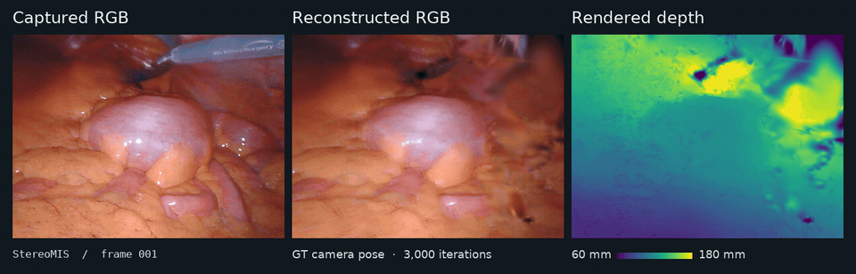
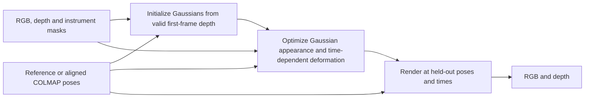

# EH-SurGS · Endoscopic scene reconstruction

Reconstruct moving tissue with deformable 3D Gaussians and render a surgical scene from a held-out camera view. This research project extends EH-SurGS with a native StereoMIS sequence loader, interchangeable camera poses, and experiments on contour-guided pose refinement.

[View the reconstruction](#reconstruction) · [Method](#method) · [Results](#results) · [Run locally](#run-locally) · [Citation](#citation)

## Reconstruction

[](docs/assets/stereomis-reconstruction.mp4)

**[Open the full-resolution video](docs/assets/stereomis-reconstruction.mp4)** · [Download MP4](https://raw.githubusercontent.com/Viiitoo/EH-SurGS-clean/main/docs/assets/stereomis-reconstruction.mp4) · [Metrics for this run](docs/assets/demo-results.json)

Read left to right to compare the captured folds and vessels with their reconstructed appearance and depth. The model saw 175 training views. The animation plays all 25 held-out views in order at four views per second. The depth colors span 60–180 mm across the entire clip.

## Method



The loader uses calibration to back-project up to 50,000 tissue pixels into 3D. Training fits appearance and deformation to the masked RGB and depth observations. The adaptive motion hierarchy compares local image errors with and without deformation to select which Gaussians can move. Swapping the pose input lets us measure how a different camera trajectory changes the rendered result.

A separate experiment projects 3D contours from MASt3R pointmaps onto 2D tissue edges. On this sequence the projected contour distance could decrease while camera translation error increased. [Contour experiments](docs/phase0_issue_summary.md) · [Pointmap camera calibration](docs/mast3r_effective_camera.md)

## Results

All rows use the same 200-frame `stereo_seq_easy` sequence, 3,000 training iterations and 25 held-out views. For scoring, the evaluator applies the valid-depth and instrument mask to both images before computing the metrics.

| Camera poses | PSNR ↑ (dB) | SSIM ↑ | LPIPS ↓ |
| --- | ---: | ---: | ---: |
| Reference poses · **demo run** | **34.9252** | **0.9072** | **0.1628** |
| Reference poses · earlier run | 34.9203 | 0.9074 | 0.1624 |
| COLMAP aligned to the reference trajectory · earlier run | 35.4949 | 0.9161 | 0.1378 |

COLMAP registered 78 of the 200 frames. A similarity transform aligned those poses to ground truth, and each remaining frame inherited the nearest registered pose in time. The last row measures rendering quality under that controlled setup. [Experiment log and mask comparison](docs/experiment_metrics.md)

## Run locally

Use Linux, Python 3.10, an NVIDIA GPU, and a CUDA 11.8 toolkit with `nvcc` and a compatible C++ compiler. The demo ran on one RTX 4090.

```bash
git clone https://github.com/Viiitoo/EH-SurGS-clean.git
cd EH-SurGS-clean
conda create -n eh-surgs python=3.10 -y
conda activate eh-surgs
python -m pip install torch==2.1.0 torchvision==0.16.0 --index-url https://download.pytorch.org/whl/cu118
python -m pip install -r requirements-phase0.txt
python -m pip install --no-build-isolation ./submodules/simple-knn ./submodules/depth-diff-gaussian-rasterization
```

Point `SEQ` to a **prepared S3PO-format sequence**. Use matching zero-padded frame names. Reference poses are 4×4 camera-to-world matrices with translation in metres. The loader scales them to millimetres to match the depth PNGs. [StereoMIS dataset](https://zenodo.org/records/7727692) · [Loader](scene/s3po_stereomis_loader.py)

```text
train/
├── rgb/                000000.png, 000001.png, …
├── depth/              one depth PNG per frame, in millimetres
├── gt/                 one camera-to-world matrix per frame, as text
├── calib/              text calibration with fx, fy, cx and cy
└── instrument_mask/    nonzero pixels mark instruments (used for the demo)
```

Run these commands from the checkout. Complete rendering before training another model there, as the renderer reads the most recent training run’s `deformation_mask.npy` from the working directory.

```bash
SEQ=/path/to/stereo_seq_easy/train
CFG=arguments/s3po/stereo_seq_easy.py
MODEL=output/stereo-gt
python train.py -s "$SEQ" -m "$MODEL" --configs "$CFG"
python render.py -m "$MODEL" --configs "$CFG" --skip_train --skip_video
python metrics.py -m "$MODEL" -p test
```

Compare the PNGs under `$MODEL/test/ours_3000/{gt,renders,depth}`. The evaluator writes `$MODEL/results.json` and `$MODEL/per_view.json`. Its first run downloads the AlexNet weights for LPIPS.

<details>
<summary><strong>Reproduce the aligned COLMAP experiment</strong></summary>

Use the same prepared sequence. The prepass reads its reference poses to resolve the scale, rotation and translation of the COLMAP trajectory.

```bash
python -m pip install pycolmap==3.13.0
python -m tools.run_s3po_colmap_aligned --dataset_root "$SEQ" --output_dir data/colmap/stereo_seq_easy
CFG=arguments/s3po/stereo_seq_easy_colmap_aligned.py
MODEL=output/stereo-colmap
python train.py -s "$SEQ" -m "$MODEL" --configs "$CFG"
python render.py -m "$MODEL" --configs "$CFG" --skip_train --skip_video
python metrics.py -m "$MODEL" -p test
```

</details>

<details>
<summary><strong>Explore the experimental contour pipeline</strong></summary>

The pointmap exporter expects an S3PO-GS source tree exposing MASt3R and DUSt3R and a compatible MASt3R checkpoint. The optional STAR-Edge detector also requires its LocalSH extension and model. [S3PO-GS](https://github.com/3DAgentWorld/S3PO-GS) · [MASt3R weights](https://github.com/naver/mast3r) · [STAR-Edge setup](https://github.com/Miraclelzk/STAR-Edge)

```bash
python -m tools.run_mast3r_pointmaps --help
python -m tools.run_s3po_contour_refine --help
```

</details>

## Citation

This project builds on the ICRA 2025 work by Jiwei Shan, Zeyu Cai, Cheng-Tai Hsieh, Shing Shin Cheng and Hesheng Wang. Please cite their paper when using the reconstruction method. [Paper](https://arxiv.org/abs/2501.01101) · [Original EH-SurGS implementation and acknowledgements](https://github.com/IRMVLab/EH-SurGS)

```bibtex
@article{shan2025deformable,
  title   = {Deformable Gaussian Splatting for Efficient and High-Fidelity Reconstruction of Surgical Scenes},
  author  = {Shan, Jiwei and Cai, Zeyu and Hsieh, Cheng-Tai and Cheng, Shing Shin and Wang, Hesheng},
  journal = {arXiv preprint arXiv:2501.01101},
  year    = {2025}
}
```

StereoMIS imagery is credited to Michel Hayoz and Max Allan. The comparison GIF and MP4 use resized StereoMIS frames alongside model predictions, with labels and a depth color map added. These two media files are shared under CC BY-NC-SA 4.0. The reconstruction code retains the upstream Gaussian-Splatting research license. [Dataset and citation](https://zenodo.org/records/7727692) · [Media license](https://creativecommons.org/licenses/by-nc-sa/4.0/) · [Code license](LICENSE.md)
