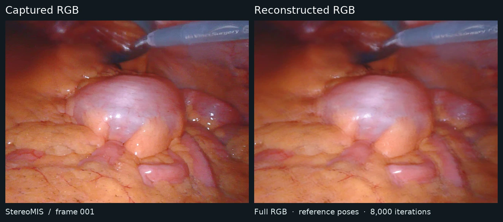
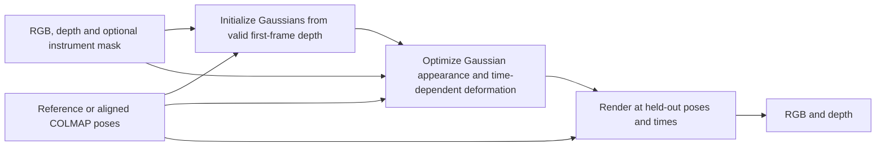

# EH-SurGS · Endoscopic scene reconstruction

Reconstruct moving tissue with deformable 3D Gaussians and render a surgical scene from a held-out camera view. This research project extends EH-SurGS with a native StereoMIS sequence loader, interchangeable camera poses, and experiments on contour-guided pose refinement.

[View the reconstruction](#reconstruction) · [Method](#method) · [Results](#results) · [Run locally](#run-locally) · [Citation](#citation)

## Reconstruction

[](docs/assets/full-rgb.mp4)

**[Play the native-resolution video with depth](docs/assets/full-rgb.mp4)** · [Compare the instrument and vessels at original pixel size](docs/assets/full-rgb-frame097.png) · [Evaluator output](docs/assets/full-rgb-results.json) · [Per-frame scores](docs/assets/run-comparison.csv)

The model trained on 175 views and rendered the remaining 25 at their reference poses. The instrument shaft and the vessels near its tip are visible in the new render. This run includes instrument pixels in RGB and depth supervision. Its **full-image PSNR is 34.29 dB** and **full-image LPIPS is 0.165**. The clip plays four held-out views per second. Its depth scale stays fixed at 60–180 mm.

## Method



The loader uses calibration to back-project up to 50,000 valid first-frame pixels into 3D. Training fits appearance and deformation to RGB and depth observations. The full-scene preset keeps positive-depth pixels, including instruments. The tissue preset also excludes the instrument mask. The adaptive motion hierarchy compares local image errors with and without deformation to select which Gaussians can move. Swapping the pose input lets us measure how a different camera trajectory changes the rendered result.

A separate experiment projects 3D contours from MASt3R pointmaps onto 2D tissue edges. On this sequence the projected contour distance could decrease while camera translation error increased. [Contour experiments](docs/phase0_issue_summary.md) · [Pointmap camera calibration](docs/mast3r_effective_camera.md)

## Results

All four runs used the same 175 training views and 25 held-out views from the 200-frame `stereo_seq_easy` sequence. We compared the original 640 × 480 render and capture for every held-out frame. The first three metrics cover every RGB pixel. The final column uses only positive-depth pixels outside the instrument mask. Each column averages the per-frame scores.

| Pose, training region and iteration count | Full PSNR ↑ (dB) | Full SSIM ↑ | Full LPIPS ↓ | Tissue PSNR ↑ (dB) |
| --- | ---: | ---: | ---: | ---: |
| Reference poses · full scene · 8,000 steps **(demo)** | 34.29 | 0.8861 | 0.1646 | 34.70 |
| Reference poses · full scene · 3,000 steps | 33.01 | 0.8680 | 0.2590 | 33.62 |
| Reference poses · instrument mask · 3,000 steps (previous demo) | 23.17 | 0.8076 | 0.3970 | 33.59 |
| Aligned COLMAP · instrument mask · 3,000 steps | 19.56 | 0.7787 | 0.3661 | 34.20 |

The 8,000-step run also grows more Gaussians during the first 3,000 iterations. We used the held-out comparisons to select the homepage example. On this closely spaced sequence, directly copying the preceding training image gives 33.85 dB, SSIM 0.8977 and LPIPS 0.0674. That comparison uses a neighboring observation and requires no 3D reconstruction. [Run comparison by frame](docs/assets/run-comparison.csv)

<details>
<summary><strong>Why the earlier tissue-only demo reported 34.93 dB</strong></summary>

The original evaluator zeroed excluded pixels in both images and divided by the full image size. On the previous demo this gave 34.93 dB. Evaluating only the valid tissue gave 33.59 dB, and evaluating all displayed pixels gave 23.17 dB. The instrument mask excluded 26.48% of each frame on average, including nearby tissue. [Previous demo audit](docs/assets/demo-psnr-by-frame.csv) · [Previous error map](docs/assets/demo-psnr-frame097.png)

The aligned COLMAP experiment registered 78 of the 200 frames, aligned poses to the reference trajectory by a similarity transform, and assigned each unregistered frame the nearest registered pose in time. [Earlier experiment log](docs/experiment_metrics.md)

</details>

## Run locally

Use Linux, Python 3.10, an NVIDIA GPU, and a CUDA 11.8 toolkit with `nvcc` and a compatible C++ compiler. The demo ran on one RTX 4090.

```bash
git clone https://github.com/Viiitoo/EH-SurGS-clean.git
cd EH-SurGS-clean
conda create -n eh-surgs python=3.10 -y
conda activate eh-surgs
python -m pip install torch==2.1.0 torchvision==0.16.0 --index-url https://download.pytorch.org/whl/cu118
python -m pip install -r requirements-phase0.txt
python -m pip install --no-build-isolation ./submodules/simple-knn ./submodules/depth-diff-gaussian-rasterization
```

Point `SEQ` to a **prepared S3PO-format sequence**. Use matching zero-padded frame names. Reference poses are 4×4 camera-to-world matrices with translation in metres. The loader scales them to millimetres to match the depth PNGs. [StereoMIS dataset](https://zenodo.org/records/7727692) · [Loader](scene/s3po_stereomis_loader.py)

```text
train/
├── rgb/                000000.png, 000001.png, …
├── depth/              one depth PNG per frame, in millimetres
├── gt/                 one camera-to-world matrix per frame, as text
├── calib/              text calibration with fx, fy, cx and cy
└── instrument_mask/    nonzero pixels mark instruments for tissue-only scoring
```

Run these commands from the checkout. Complete rendering before training another model there, as the renderer reads the most recent training run’s `deformation_mask.npy` from the working directory.

```bash
SEQ=/path/to/stereo_seq_easy/train
CFG=arguments/stereo_seq_easy_full_rgb.py
MODEL=output/stereo-full-rgb
python train.py -s "$SEQ" -m "$MODEL" --configs "$CFG" --save_iterations 8000
python render.py -m "$MODEL" --configs "$CFG" --skip_train --skip_video
python metrics.py -m "$MODEL" -p test
```

Compare the PNGs under `$MODEL/test/ours_8000/{gt,renders,depth}`. The evaluator writes `$MODEL/results.json` and `$MODEL/per_view.json`. All 25 test frames have positive depth throughout, so this preset gives full-image scores for the demo. The first evaluation downloads the AlexNet weights for LPIPS. The earlier tissue-only training configuration is [available here](arguments/s3po/stereo_seq_easy.py).

<details>
<summary><strong>Reproduce the aligned COLMAP experiment</strong></summary>

Use the same prepared sequence. The prepass reads its reference poses to resolve the scale, rotation and translation of the COLMAP trajectory.

```bash
python -m pip install pycolmap==3.13.0
python -m tools.run_s3po_colmap_aligned --dataset_root "$SEQ" --output_dir data/colmap/stereo_seq_easy
CFG=arguments/s3po/stereo_seq_easy_colmap_aligned.py
MODEL=output/stereo-colmap
python train.py -s "$SEQ" -m "$MODEL" --configs "$CFG"
python render.py -m "$MODEL" --configs "$CFG" --skip_train --skip_video
python metrics.py -m "$MODEL" -p test
```

</details>

<details>
<summary><strong>Explore the experimental contour pipeline</strong></summary>

The pointmap exporter expects an S3PO-GS source tree exposing MASt3R and DUSt3R and a compatible MASt3R checkpoint. The optional STAR-Edge detector also requires its LocalSH extension and model. [S3PO-GS](https://github.com/3DAgentWorld/S3PO-GS) · [MASt3R weights](https://github.com/naver/mast3r) · [STAR-Edge setup](https://github.com/Miraclelzk/STAR-Edge)

```bash
python -m tools.run_mast3r_pointmaps --help
python -m tools.run_s3po_contour_refine --help
```

</details>

## Citation

This project builds on the ICRA 2025 work by Jiwei Shan, Zeyu Cai, Cheng-Tai Hsieh, Shing Shin Cheng and Hesheng Wang. Please cite their paper when using the reconstruction method. [Paper](https://arxiv.org/abs/2501.01101) · [Original EH-SurGS implementation and acknowledgements](https://github.com/IRMVLab/EH-SurGS)

```bibtex
@article{shan2025deformable,
  title   = {Deformable Gaussian Splatting for Efficient and High-Fidelity Reconstruction of Surgical Scenes},
  author  = {Shan, Jiwei and Cai, Zeyu and Hsieh, Cheng-Tai and Cheng, Shing Shin and Wang, Hesheng},
  journal = {arXiv preprint arXiv:2501.01101},
  year    = {2025}
}
```

StereoMIS imagery is credited to Michel Hayoz and Max Allan. The animations, videos and comparison figures use StereoMIS frames alongside model predictions, with labels, color maps, crops and mask overlays. These media files are shared under CC BY-NC-SA 4.0. The reconstruction code retains the upstream Gaussian-Splatting research license. [Dataset and citation](https://zenodo.org/records/7727692) · [Media license](https://creativecommons.org/licenses/by-nc-sa/4.0/) · [Code license](LICENSE.md)
